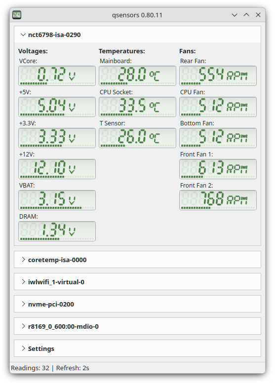

# qsensors

Qt6/Wayland-oriented sensor monitor with an xsensors-inspired UI and direct
`libsensors` access.



## Dependencies

- C++20 compiler
- CMake 4.2 or newer
- Qt6 (`Core`, `Gui`, `Widgets`, and the Linguist tools for the translations;
  `Test` only when building the tests)
- `libsensors` (lm-sensors)

## Build

```bash
cmake -S . -B build -DCMAKE_BUILD_TYPE=Release
cmake --build build -j
```

| Option | Default | Effect |
|---|---|---|
| `BUILD_TESTING` | `ON` | Builds the tests (needs Qt Test); run them with `ctest --test-dir build` |
| `QSENSORS_WARNINGS_AS_ERRORS` | `OFF` | Treats compiler warnings in qsensors code as errors |
| `QSENSORS_SANITIZE` | `OFF` | Builds with AddressSanitizer and UndefinedBehaviorSanitizer |

## Run

```bash
./build/qsensors
```

## Releases

Development happens on `develop`; `main` only contains released states.
Releases are tagged `vX.Y.Z` on `main`, which builds both AppImages and creates
a GitHub release draft. Prebuilt AppImages are attached to the
[GitHub releases](https://github.com/ccharon/qsensors/releases). They bundle
Qt 6.8 with the Wayland and X11 platform plugins; Qt picks one at startup.

| AppImage | Architecture | Minimum glibc | Examples |
|---|---|---|---|
| `qsensors-X.Y.Z-x86_64.AppImage` | x86_64 | 2.28 | RHEL/Alma/Rocky 8+, Debian 11+, Ubuntu 20.04+ |
| `qsensors-X.Y.Z-aarch64.AppImage` | arm64 | 2.39 | Ubuntu 24.04+, Debian 13+, Fedora 40+ |

Build an AppImage locally inside the matching container, e.g. for arm64:
`docker run --rm -v "$PWD":/src -w /src -e VERSION=0.80.10 ubuntu:24.04 bash packaging/appimage/build.sh`

## Configuration

`QSettings` on Linux, typically:

`~/.config/qsensors/qsensors.conf`

Runtime keys currently used:
- `runtime/polling_interval_sec` (1 to 10 seconds, default 2)
- `runtime/fan_default_max_rpm` (500 to 9999, default 5000)
- `runtime/temperature_unit` (`C` or `F`, default `C`)

The settings panel changes these values. The window size, the chip order and
the collapsed chips are stored under `ui/`. The chip order and the collapsed
chips are saved as soon as they change, the window size when the window closes.

## Sensor range policy (normalization)

Readings are normalized before they are rendered:
- native firmware limits are used when available; placeholder limits (for
  example min = max = 0, or the -273.15 / 65261.85 degrees C of NVMe secondary
  sensors) are ignored
- the bar graph range is completed by category defaults where the firmware
  reports no limits; alerts come from firmware limits only (temperatures
  without a firmware maximum turn red above 100 degrees C)
- for temperature readings, values and limits are in the selected display
  unit (`C` or `F`)
- a sensor that cannot be read at the moment keeps its card and shows dashes

The sensors are read in a background thread. The status bar shows the number of
readings and the refresh interval, or the reason when libsensors cannot be
initialized, no sensors are found, or a read does not return.

## License

This project is licensed under **GPL-2.0-or-later**.

- Full text: [`LICENSE`](./LICENSE)
